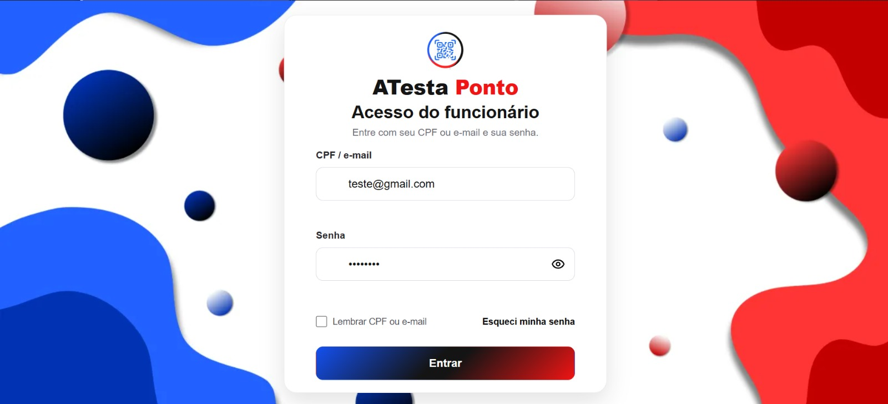

# ATestaPonto

Sistema de ponto escolar com Java 21, Spring Boot, MySQL, Redis e frontend HTML/CSS/JavaScript.

- `atesta-gateway/`: aplicação principal Spring, Maven Wrapper, Docker e fontes do frontend em `web/`.
- `atesta-id/`: simulador OAuth independente, exclusivo de desenvolvimento/testes; mantém seu próprio Node/npm.
- `database/`: baseline e migrations SQL existentes; nada é aplicado no startup.

## Configuração e execução

Requisitos da aplicação principal: JDK 21, MySQL e Redis. O Maven Wrapper usa o Maven configurado em `.mvn/`. Node/npm não são necessários para compilar, empacotar ou executar a aplicação principal.

```bash
cd atesta-gateway
cp .env.example .env
./mvnw clean verify
./mvnw spring-boot:run
```

No Windows, use `mvnw.cmd` no lugar de `./mvnw`. Preencha `.env` localmente; nunca versione ou compartilhe seus valores. A precedência é propriedades Java/ambiente sobre `.env`. O `.env` é lido somente no diretório de execução. `SERVER_PORT` e demais variáveis de infraestrutura devem ser exportadas no ambiente; a porta padrão é 8081.

Configure as variáveis de `atesta-gateway/.env.example`:

- MySQL: `DB_HOST`, `DB_PORT`, `DB_USER`, `DB_PASSWORD`, `DB_NAME`. Para CA própria, `DB_SSL_ENABLED=true` e `DB_SSL_CA_BASE64`; TLS verifica certificado e hostname, sem fallback inseguro.
- Redis: `REDIS_HOST`, `REDIS_PORT`, `REDIS_USERNAME`, `REDIS_PASSWORD`, `REDIS_TLS`, `REDIS_NAMESPACE`. Sessões administrativas sempre exigem Redis. `REDIS_ENABLED` também controla QR, recuperação e rate limiting distribuídos; em produção, mantenha-o habilitado.
- OAuth: `GOVBR_AUTHORIZE_URL`, `GOVBR_TOKEN_URL`, `GOVBR_USERINFO_URL`, `GOVBR_CLIENT_ID`, `GOVBR_CLIENT_SECRET`, `GOVBR_REDIRECT_URI`, `GOVBR_LOGOUT_URL`. O callback precisa corresponder à URL/porta publicada.
- Cookies: `ADMIN_SESSION_SECURE` exige HTTPS quando `true`; desabilite apenas para HTTP local. Preserve `ADMIN_SESSION_TTL_SECONDS`.
- Segredos distintos e fornecidos pelo ambiente: `JWT_SECRET`, `SESSION_SECRET`, `INTERNAL_API_SHARED_KEY`. A chave interna permanece obrigatória para os contratos `/internal/**`, protegidos por HMAC e anti-replay; navegadores usam as APIs públicas diretamente.
- `NODE_ENV` continua como nome de configuração compatível para definir `production`; não indica dependência do runtime Node.
- E-mail e limites: use os campos `MAIL_*`, `SMTP_*` e de rate limiting do exemplo. Nunca registre credenciais, destinatários ou códigos.

Para executar o JAR, a partir de `atesta-gateway/`:

```bash
java -jar target/atesta-gateway-0.0.1-SNAPSHOT.jar
```

O Maven inclui páginas, CSS, ícones, fontes, imagens e módulos JavaScript de `web/` no JAR. Também gera os sete bundles de compatibilidade em `target/classes`; edite as fontes de `web/`, sem executar npm. Páginas administrativas ficam fora do diretório público e continuam protegidas por sessão e RBAC.

## Transição do Express

A aplicação principal passou a ser exclusivamente Spring. As APIs públicas, páginas e aliases POST `/ponto/*` são atendidos diretamente, sem proxy Node. `/health` mantém o envelope `success/data/error` anterior e o estado de MySQL/Redis; `/ready` exige MySQL e Redis mesmo quando `REDIS_ENABLED=false`.

Cookies `connect.sid` do Express não autenticam no Spring. Uma sessão antiga exige novo login OAuth/PKCE; `/auth/govbr/login` também expira o cookie antigo. O novo login renova a sessão e revalida cadastro, capacidades e território. Recuperações de senha iniciadas no Express precisam ser solicitadas novamente: o Spring usa cookie e namespace próprios. Não há importação de sessões nem limpeza dos registros antigos em Redis; eles expiram pelo TTL existente.

Após a mudança de diretório, mantenha a configuração Spring no novo `atesta-gateway/.env`. Não copie automaticamente o `.env` Express: mapeie os nomes conforme o exemplo, sem reutilizar configurações do simulador como produção. Instalações editáveis da CLI no caminho antigo precisam ser reinstaladas.

## Build e publicação por Docker

```bash
docker build -t atestaponto ./atesta-gateway
docker run --env-file /caminho/seguro/atestaponto.env -p 8081:8081 atestaponto
```

A imagem usa Java 21, usuário sem privilégios e health check `/ready`. `.env`, chaves e certificados privados ficam fora do contexto. O deploy deve fornecer MySQL, Redis, OAuth, SMTP e configuração de proxy por ambiente. Ajuste o proxy para o `SERVER_PORT` publicado e preserve a URL de callback. Este repositório não publica ambientes automaticamente.

A antiga Function Express/Vercel não é um destino compatível com este JAR: a aplicação principal deve executar no host/container Java configurado. Nenhuma infraestrutura ou implantação remota foi alterada. O simulador `atesta-id` mantém sua configuração própria, inclusive Vercel.

## Ferramentas de banco

A CLI Python existente foi mantida e ampliada, sem dependência de Node:

```bash
pipx install --force -e ./atesta-gateway/scripts/atesta-db
atesta-db check
```

Requer Python 3.11+ e as dependências declaradas no `pyproject.toml`. Execute dentro do repositório. A configuração vem do ambiente, depois de `atesta-gateway/.env`; `DB_PASS` é um alias legado de `DB_PASSWORD`. TLS usa a mesma CA configurada para o backend. `check` abre uma sessão read-only e executa somente `SELECT 1`.

Com autorização explícita para modificar o banco, os comandos manuais são:

```bash
atesta-db init
atesta-db apply --migration 20260908_ponto_idempotencia
```

`init` aplica somente o baseline canônico e recusa banco com tabelas/views. `apply` aplica migrations autorizadas explicitamente pelo ID (ex.: `20260908_ponto_idempotencia`); não aceita caminhos arbitrários, nem inicializa o schema automaticamente. Em produção, os dois exigem `--confirm-production`. SQL pode ter efeitos irreversíveis e DDL MySQL não garante rollback; confira o destino antes de autorizar. Estes comandos não fazem parte do build/startup.

## Simulador independente

Para desenvolvimento/testes, configure `atesta-id/.env` conforme seu próprio exemplo e execute em outro terminal:

```bash
cd atesta-id
npm install
npm start
```

Configure nesse ambiente as URLs do gateway e faça corresponder cliente/segredo ao OAuth do Spring. Os nomes de configuração do simulador permanecem próprios (`GOVBR_FAKE_*`); não são automaticamente aliases das variáveis Spring. Não use dados pessoais reais nem execute o simulador em produção.

## Como Usar o Sistema

### Como Funciona o Login do Funcionário

O funcionário pode fazer login usando CPF ou e-mail cadastrado:



| Campo | Descrição |
|---|---|
| CPF ou E-mail | CPF sem pontos e traços (apenas números) ou e-mail cadastrado pelo administrador. |
| Senha | Senha definida pelo administrador no momento do cadastro do funcionário. |

> [!IMPORTANT]
> No cadastro atual, o sistema retorna uma senha temporária uma única vez para o administrador. Essa senha deve ser entregue ao funcionário por um canal seguro definido pela escola.

### Como Registrar as Batidas de Ponto

O sistema reconhece automaticamente o tipo de registro com base na sequência de batidas do dia:

| Batida | Tipo de Registro |
|---|---|
| 1ª batida do dia | Entrada |
| 2ª batida do dia | Saída para almoço |
| 3ª batida do dia | Retorno do almoço |
| 4ª batida do dia | Saída |

**Requisitos para registrar o ponto:**
1. Login válido (CPF/e-mail + senha)
2. Leitura do QR Code da unidade escolar
3. Localização dentro do raio permitido pela escola (geolocalização)

### Perfis Administrativos e Escopos

O sistema possui perfis administrativos hierárquicos com diferentes níveis de acesso:

| Perfil | Escopo Territorial | Principais Capacidades |
|---|---|---|
| **ADMIN_SEDUC** | Estadual (todas as DREs e escolas) | Cadastrar escolas, gerenciar DREs, conceder acessos ADMIN_DIRETORIA/SECRETARIA/COORDENADOR, visualizar relatórios estaduais |
| **ADMIN_DIRETORIA** | Diretoria de Ensino (DRE específica) | Cadastrar escolas da DRE, conceder acessos DIRETOR/VICE_DIRETOR/SECRETARIA/COORDENADOR, visualizar relatórios da DRE |
| **DIRETOR** | Unidade escolar específica | Gerenciar funcionários da escola, gerar QR Code, conceder acessos SECRETARIA/COORDENADOR, visualizar relatórios da escola |
| **VICE_DIRETOR** | Unidade escolar específica | Mesmas capacidades do DIRETOR |
| **SECRETARIA** | Unidade escolar específica | Cadastrar e editar funcionários, gerar QR Code, visualizar ponto e relatórios da escola |
| **COORDENADOR** | Unidade escolar específica | Visualizar funcionários, ponto e relatórios da escola (sem edição) |

**Matriz de Delegação:**
- ADMIN_SEDUC pode conceder: ADMIN_DIRETORIA, SECRETARIA, COORDENADOR
- ADMIN_DIRETORIA pode conceder: DIRETOR, VICE_DIRETOR, SECRETARIA, COORDENADOR
- DIRETOR/VICE_DIRETOR podem conceder: SECRETARIA, COORDENADOR
- SECRETARIA e COORDENADOR não podem conceder acessos

### Funcionalidades Administrativas

#### Cadastro de Escolas

- Disponível para: ADMIN_SEDUC (todas as DREs) e ADMIN_DIRETORIA (apenas sua DRE)
- Integração automática com **BrasilAPI v2** para validação de CEP e obtenção de coordenadas
- O backend Spring processa o cadastro e valida a diretoria de ensino
- Não é necessária chave de API para a consulta de CEP

#### Gestão de Funcionários

- Cadastro inclui: nome, CPF, e-mail, telefone, cargo, horários e vínculo com unidade escolar
- Sistema gera senha temporária no primeiro cadastro
- Perfis com capacidade `funcionario.criar`: ADMIN_SEDUC, ADMIN_DIRETORIA, DIRETOR, VICE_DIRETOR, SECRETARIA

#### Geração de QR Code

- Exclusivo para perfis escolares: DIRETOR, VICE_DIRETOR, SECRETARIA
- QR Code vinculado à unidade escolar do administrador
- Funcionários leem o QR Code para validar presença física na escola

#### Relatórios

O sistema oferece três tipos de relatórios:

| Tipo | Descrição | Filtros |
|---|---|---|
| **Diário** | Registros de ponto de uma data específica | Data, escopo (unidade ou global conforme perfil) |
| **Semanal** | Resumo semanal de registros | Semana (ano + número), escopo |
| **Hierárquico** | Agregação por escola, DRE ou estado | Período, nível de agregação, escopo |

Todos os relatórios respeitam o escopo territorial do administrador autenticado.


## Validação e homologação

`./mvnw clean verify` compila, executa a suíte Java e empacota o JAR. O Mockito usa agente explícito na versão gerenciada pelo Spring Boot. Compilação e testes com mocks não homologam MySQL, Redis, OAuth, SMTP, navegador ou infraestrutura. Reutilize as evidências HML de negócio já aprovadas; a troca de runtime e publicação ainda exige homologação operacional antes de produção.
